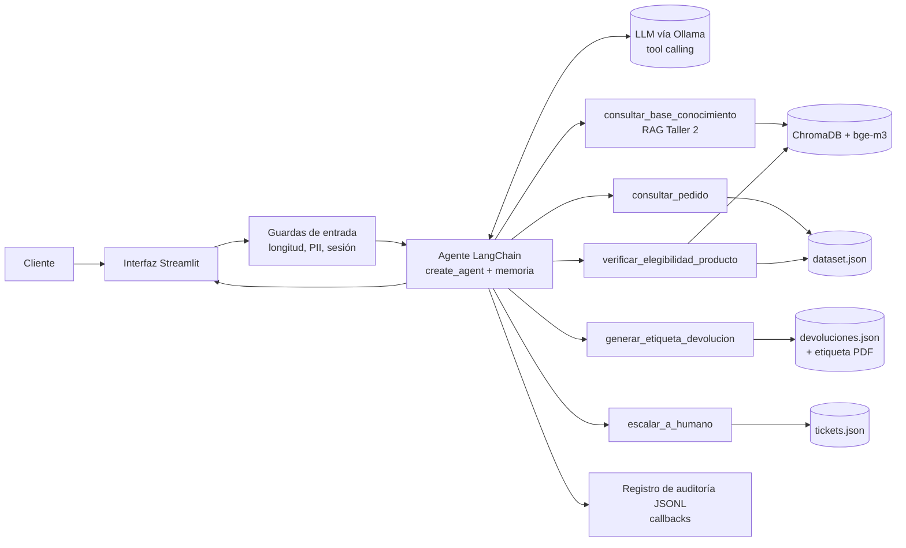
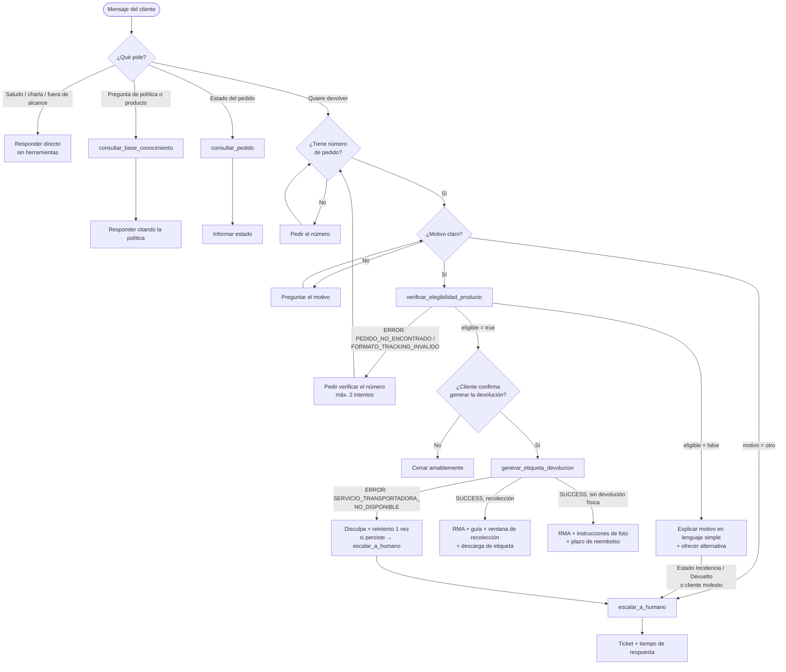

# Fase 1 — Diseño de la Arquitectura del Agente

---

En el Taller 2 se construyó un asistente para EcoMarket capaz de **responder** con
información recuperada del manual de políticas, el catálogo y las FAQ. En el Proyecto Final
se le otorga la capacidad de **actuar**: verificar si un producto admite devolución y generar
la etiqueta correspondiente sin intervención humana. En esta fase se define cómo se integra el
RAG existente en la nueva arquitectura, qué herramientas utiliza el agente, con qué marco se
construye y cómo fluye el proceso de devolución.

Dos resultados del [Taller 2](../../taller_2/analisis/resultados_pruebas.md) condicionan el
diseño:

- Aun con la regla correcta en el contexto, el modelo de 3B parámetros **rechazó una garantía
  vigente** porque debía combinar dos políticas (caso 3). Por esta razón, en el diseño
  propuesto la decisión de elegibilidad **no recae en el LLM**: se calcula mediante una
  herramienta determinista, y al LLM le corresponde decidir *cuándo* invocarla y *cómo*
  comunicar el resultado.
- El mecanismo de fallo seguro (escalar a un humano cuando no hay fundamento) funcionó
  correctamente, por lo que se conserva como política del agente ante cualquier error o duda.

## Contenido

- [1. Extensión de la arquitectura RAG](#1-extensión-de-la-arquitectura-rag)
- [2. Definición de las herramientas](#2-definición-de-las-herramientas)
- [3. Selección del marco de agentes](#3-selección-del-marco-de-agentes)
- [4. Selección del LLM para tool calling](#4-selección-del-llm-para-tool-calling)
- [5. Flujo de trabajo del proceso de devolución](#5-flujo-de-trabajo-del-proceso-de-devolución)
- [6. Resumen de la decisión](#6-resumen-de-la-decisión)

---

## 1. Extensión de la arquitectura RAG

Se evaluaron dos formas de incorporar el RAG del Taller 2 al agente:

| Opción | Cómo funciona | Ventajas | Desventajas |
| :--- | :--- | :--- | :--- |
| **A. Router por reglas** | Un clasificador (regex/palabras clave o LLM) envía la consulta a la ruta RAG o a la ruta agente. | Determinista, barato, fácil de probar. | Rígido con consultas mixtas ("mi panel no funciona, ¿qué garantía tiene y cómo lo devuelvo?"); exige mantener las reglas; un error de ruta no se recupera en ese turno. |
| **B. RAG como herramienta**  | El agente (*tool calling*) tiene `consultar_base_conocimiento` junto a las herramientas de acción y decide cuál usar, en qué orden y cuántas veces. | Resuelve consultas mixtas en un solo turno; un único punto de entrada; el agente decide cuándo consultar la política y cuándo actuar. | Depende de que el LLM elija bien. Se mitiga con descripciones precisas de las herramientas, guardas en código y un modelo con buen *tool calling*. |

**Decisión:** se eligió la opción B, complementada con una **capa de guardas deterministas**
antes y después del agente: validación del formato del número de seguimiento, límite de
llamadas a herramientas por turno y verificación de elegibilidad dentro de
`generar_etiqueta_devolucion`. De este modo se aprovecha la flexibilidad del agente sin delegar
las decisiones críticas al LLM. La opción A se mantiene como alternativa y como posible
"camino rápido" en producción, en el que los saludos y las preguntas frecuentes se atenderían
sin pasar por el agente para reducir la latencia.

---

## 2. Definición de las herramientas

Se definieron **cuatro herramientas además del RAG**. Las dos centrales del proceso son
`verificar_elegibilidad_producto` y `generar_etiqueta_devolucion`; `consultar_pedido` y
`escalar_a_humano` completan el flujo con las consultas de estado y la transferencia a un
asesor.

Todas las herramientas siguen una convención común:

- Entradas validadas con un esquema **Pydantic** (tipos, `Literal` para los motivos, regex
  `ECO-\d{4}-\d{4}` para el número de seguimiento).
- **Nunca lanzan excepciones al agente.** Devuelven siempre un objeto con el atributo
  `status`, cuyo valor es `"SUCCESS"` o `"ERROR"`. Si `status` es `"ERROR"`, incluyen
  `error_code` (enumerado), `message` (texto para el LLM) y, cuando aplica,
  `suggested_action`:
  `{"status": "ERROR", "error_code": "PEDIDO_NO_ENCONTRADO", "message": "No existe un pedido con el número ECO-2099-9999", "suggested_action": "Pedir al cliente que verifique el número"}`.
- Los **nombres de los atributos** del JSON de salida están en **inglés**; los **valores**
  (mensajes, códigos, vías, instrucciones) están en **español**.
- No exponen datos personales innecesarios (nombre de pila sí; dirección completa no).
- Son **funciones simuladas**: leen y escriben archivos JSON locales que representan el ERP, el
  sistema de la transportadora y la mesa de ayuda.

### T0. `consultar_base_conocimiento` (RAG existente)

| Campo | Detalle |
| :--- | :--- |
| Propósito | Responder preguntas sobre políticas, productos y FAQ. |
| Entrada | `consulta: str`, `sku: str \| None` |
| Implementación | `rag.recuperar(consulta, sku)` + `rag.formatear_contexto()` del Taller 2 |
| Salida exitosa | `{"status": "SUCCESS", "fragments": "[1] (politicas · 4.1 Derecho de retracto) ...", "sources": [...]}` |
| Errores | `BASE_CONOCIMIENTO_NO_DISPONIBLE` (ChromaDB caído o vacío), `SIN_RESULTADOS` |
| Cuándo la usa el agente | Preguntas generales: "¿puedo devolver un jabón abierto?", "¿cuánto tarda el reembolso?", "¿el panel tiene garantía?" |

### T1. `consultar_pedido`

| Campo | Detalle |
| :--- | :--- |
| Propósito | Obtener estado, producto y fechas de un pedido. |
| Entrada | `tracking_number: str` (formato `ECO-AAAA-NNNN`) |
| Implementación | `db.buscar_pedido()` filtrando a `CAMPOS_DEVOLUCION`, sin dirección. |
| Salida exitosa | `{"status": "SUCCESS", "order": {"tracking_number": "ECO-2024-0002", "customer": "Ana", "product": "...", "category": "Hogar", "order_status": "En tránsito", "delivered_date": null, ...}}` |
| Errores | `FORMATO_TRACKING_INVALIDO`, `PEDIDO_NO_ENCONTRADO` |
| Cuándo la usa el agente | "¿Dónde está mi pedido ECO-2024-0002?" o como primer paso de una devolución. |

### T2. `verificar_elegibilidad_producto`

| Campo | Detalle |
| :--- | :--- |
| Propósito | Decidir **en código** si el pedido admite devolución y por qué vía. |
| Entrada | `tracking_number: str`, `motivo: Literal["cambio_de_opinion","talla_incorrecta","producto_danado","producto_defectuoso","producto_equivocado","otro"]` |
| Lógica | Árbol de decisión del Taller 2 trasladado a Python: estado → motivo → vía → exclusiones (`is_perishable`, `is_hygiene_item`, categoría Suscripción) → ventana (`dias_habiles` para retracto, días calendario para garantía) → garantía del fabricante (Tecnología, ≤ 365 días) → devolución física o no. La fecha de referencia sale de `FECHA_REFERENCIA` (o `date.today()`). |
| Salida exitosa (elegible) | `{"status": "SUCCESS", "eligible": true, "return_method": "retracto"\|"garantia"\|"garantia_fabricante", "requires_physical_return": true, "days_since_delivery": {"business_days": 3, "calendar_days": 4}, "return_window": "5 días hábiles", "refund_timeframe": "5 a 10 días hábiles", "policy_reference": "Manual §4.1", "eligibility_token": "ELG-..."}` |
| Salida exitosa (no elegible; no es un error) | `{"status": "SUCCESS", "eligible": false, "rejection_reason": "categoria_excluida_de_retracto"\|"ventana_retracto_vencida"\|"ventana_garantia_vencida"\|"pedido_no_entregado"\|"devolucion_en_curso"\|"pedido_cancelado"\|"motivo_requiere_revision", "alternative": "Si el producto llegó defectuoso puedes usar la garantía de 30 días", "policy_reference": "Manual §4.1"}` |
| Errores | `FORMATO_TRACKING_INVALIDO`, `PEDIDO_NO_ENCONTRADO`, `MOTIVO_INVALIDO` |
| Por qué determinista | Corrige el fallo del caso 3 del Taller 2 y hace la decisión auditable y verificable con pruebas, sin depender del LLM. |

### T3. `generar_etiqueta_devolucion`

| Campo | Detalle |
| :--- | :--- |
| Propósito | Crear la orden de devolución (RMA) y la etiqueta de envío. |
| Entrada | `tracking_number: str`, `motivo: <enum>`, `confirmado_por_cliente: bool` |
| Guardas internas | 1) Si `confirmado_por_cliente` es falso → `CONFIRMACION_REQUERIDA`. 2) **Vuelve a ejecutar la verificación de elegibilidad** (no confía en lo que diga el LLM) → si no es elegible, `NO_ELEGIBLE`. 3) **Idempotencia:** si ya existe una RMA para ese pedido, devuelve la existente (`already_existed: true`) en lugar de duplicarla. |
| Salida exitosa (con devolución física) | `{"status": "SUCCESS", "rma": "RMA-2026-000123", "return_type": "recoleccion", "carrier": "EcoExpress", "waybill_number": "EX123456789CO", "pickup_window": "2026-09-30 a 2026-10-02", "label_file": "data/etiquetas/RMA-2026-000123.pdf", "instructions": ["Empaca el producto en su empaque original", "..."], "refund_timeframe": "5 a 10 días hábiles", "already_existed": false}` |
| Salida exitosa (sin devolución física: higiene/perecedero en garantía) | `{"status": "SUCCESS", "rma": "...", "return_type": "sin_devolucion_fisica", "instructions": ["Envía una foto del producto a ..."], "label_file": null, "refund_timeframe": "5 a 10 días hábiles"}` |
| Errores | `CONFIRMACION_REQUERIDA`, `NO_ELEGIBLE`, `PEDIDO_NO_ENCONTRADO`, `SERVICIO_TRANSPORTADORA_NO_DISPONIBLE` (simulado con `SIMULAR_FALLA_TRANSPORTADORA=true` o un número de seguimiento concreto, para demostrar el manejo de fallos) |
| Persistencia | `data/devoluciones.json` (registro de RMAs) y `data/etiquetas/*.pdf` (o PNG con código QR). |

### T4. `escalar_a_humano`

| Campo | Detalle |
| :--- | :--- |
| Propósito | Transferir el caso a un asesor con un resumen (manual de políticas, §7). |
| Entrada | `motivo: Literal["solicitud_cliente","molestia","incidencia","devolucion_en_curso","motivo_otro","error_sistema","fuera_de_alcance"]`, `resumen: str`, `tracking_number: str \| None` |
| Salida exitosa | `{"status": "SUCCESS", "ticket_id": "TCK-2026-0042", "response_time": "24 horas", "business_hours": "L-S 7:00–20:00"}` |
| Cuándo la usa el agente | Motivo `otro`, estado Incidencia o Devuelto, cliente molesto, error repetido de una herramienta. |

---

## 3. Selección del marco de agentes

| Criterio | LangChain (v1, `create_agent` sobre LangGraph) | LlamaIndex (`FunctionAgent` / `ReActAgent`) |
| :--- | :--- | :--- |
| Continuidad con el Taller 2 | Ya se usan `langchain-core`, `langchain-chroma`, `langchain-openai` y LCEL. El RAG no se reescribe. | Habría que reenvolver ChromaDB y el retriever en abstracciones de LlamaIndex, o mezclar dos marcos. |
| Integración de herramientas | Decorador `@tool` con esquema Pydantic; *tool calling* nativo con modelos compatibles con OpenAI y con Ollama. | Bueno (`FunctionTool`), pero su fuerte es la indexación y consulta de documentos. |
| Control del flujo | *Middleware*: límite de llamadas a herramientas, *human-in-the-loop*, manejo de errores de herramientas; memoria con *checkpointer* (`InMemorySaver`) por `thread_id`. | Memoria y *workflows* disponibles, menos maduros para guardas sobre acciones. |
| Observabilidad | *Callbacks* para registrar cada llamada; integración opcional con LangSmith o Langfuse. | Instrumentación propia o integraciones. |
| Facilidad de uso | Curva media; documentación amplia. | Curva baja para RAG puro. |

**Decisión:** se seleccionó **LangChain**, dado que el flujo se centra en *acciones* más que
en recuperación documental, que el RAG del Taller 2 ya está construido en LangChain y se
reutiliza sin cambios, y que las guardas requeridas por un agente con capacidad de actuar
(límites, confirmación, memoria) vienen incorporadas en el marco.

La adopción del marco implica agregar las siguientes dependencias en `pyproject.toml`:
`langchain>=1.0`, `langgraph>=1.0`, `streamlit`, `reportlab` (o `qrcode[pil]`) para la
etiqueta y `pytest`.

---

## 4. Selección del LLM para tool calling

`qwen2.5:3b`, el modelo de los talleres anteriores, soporta *tool calling* en Ollama, pero
falla con frecuencia al elegir herramientas y al rellenar sus argumentos en flujos de varios
pasos. Por esta razón se adoptaron las siguientes decisiones:

1. Se establece **`qwen2.5:7b`** como modelo por defecto del agente (alternativa:
   `llama3.1:8b`), ambos con *tool calling* en Ollama. `qwen2.5:3b` se conserva como punto de
   comparación en las pruebas.
2. La configuración se mantiene en `.env`, lo que permite cambiar a un proveedor por API
   (`gpt-4o-mini`, Groq) si el equipo local no ofrece la latencia necesaria.
3. Se fija la temperatura del agente en **0** para que sus decisiones sean reproducibles.

---

## 5. Flujo de trabajo del proceso de devolución

En este flujo, el agente toma las siguientes decisiones:

1. **Herramienta o respuesta directa:** el agente responde sin herramientas a los saludos, los
   agradecimientos y las preguntas fuera de alcance.
2. **Datos faltantes:** el agente nunca inventa un número de seguimiento ni un motivo; los
   solicita al cliente.
3. **Orden obligatorio:** el agente invoca `verificar_elegibilidad_producto` antes de
   `generar_etiqueta_devolucion`, restricción que además se refuerza en código.
4. **Confirmación explícita:** el agente solicita la confirmación del cliente antes de ejecutar
   la acción con efecto (crear la RMA).
5. **Reintentos acotados:** ante fallos repetidos, el agente limita los reintentos y escala el
   caso a un asesor.

---

## 6. Resumen de la decisión

| Componente | Elección | Razón principal | Alternativa |
| :--- | :--- | :--- | :--- |
| Integración del RAG | **RAG como herramienta** del agente, con guardas deterministas | Resuelve consultas mixtas y deja las decisiones críticas en código | Router por reglas como camino rápido para saludos y FAQ |
| Herramientas | `consultar_base_conocimiento` + `consultar_pedido`, `verificar_elegibilidad_producto`, `generar_etiqueta_devolucion`, `escalar_a_humano` | Cubren el proceso completo: consultar, decidir, actuar y escalar | — |
| Decisión de elegibilidad | **Determinista** (Python) | Auditable y probada; corrige el fallo del Taller 2 | Decisión del LLM con la política en el contexto (Taller 2) |
| Marco de agentes | **LangChain** (`create_agent`) | Reutiliza el RAG del Taller 2; middleware y memoria incorporados | LlamaIndex |
| LLM del agente | **`qwen2.5:7b`** en Ollama, temperatura 0 | *Tool calling* fiable sin costo por token | `llama3.1:8b` o `gpt-4o-mini` por API |

---

📎 Continuar con [`Fase 2 — Implementación y Conexión de Componentes`](./fase_2_implementacion_agente.md)
