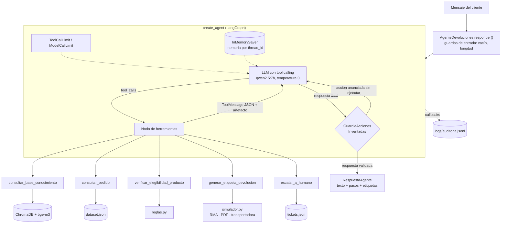

# Fase 2 — Implementación y Conexión de Componentes

---

En esta fase se implementó el agente diseñado en la
[Fase 1](./fase_1_diseño_arquitectura.md) a partir del código entregado en el Taller 2. El
RAG, el acceso a pedidos y el cliente del LLM se reutilizan sin cambios; sobre ellos se
agregaron las herramientas, el agente de LangChain, las guardas de seguridad, el registro de
auditoría y una batería de pruebas que mide cuándo el agente usa herramientas y cuándo
responde directamente.

## Contenido

- [1. Extensión del código base](#1-extensión-del-código-base)
- [2. Arquitectura del agente](#2-arquitectura-del-agente)
- [3. Herramientas implementadas](#3-herramientas-implementadas)
- [4. Inicialización del agente](#4-inicialización-del-agente)
- [5. Manejo de respuestas: éxito y error](#5-manejo-de-respuestas-éxito-y-error)
- [6. Guardas en código](#6-guardas-en-código)
- [7. Observabilidad](#7-observabilidad)
- [8. Evaluación del comportamiento](#8-evaluación-del-comportamiento)
- [9. Ajustes respecto al diseño de la Fase 1](#9-ajustes-respecto-al-diseño-de-la-fase-1)
- [10. Ejecución](#10-ejecución)

---

## 1. Extensión del código base

El proyecto se construyó como una tercera versión de la solución, en la carpeta
`proyecto_final/`, copiada del Taller 2 (sin el entorno virtual ni el índice local). Los
módulos del Taller 2 se conservan y los modos de consola anteriores siguen funcionando.

```
proyecto_final/
├── src/
│   ├── llm.py · db.py · base_conocimiento.py · rag.py      # Taller 2, sin cambios
│   ├── main.py · main_devolucion.py · prompts*.py          # Taller 1 y 2 (CLI anteriores)
│   ├── agente/                                             # NUEVO — Proyecto Final
│   │   ├── reglas.py           # Árbol de decisión de devoluciones (lógica pura, sin LLM)
│   │   ├── simulador.py        # Sistemas externos simulados: RMA, transportadora, tickets, PDF
│   │   ├── herramientas.py     # Las 5 herramientas (@tool) con esquemas Pydantic
│   │   ├── prompts_agente.py   # System prompt del agente
│   │   ├── guardas.py          # Middleware contra acciones anunciadas y no ejecutadas
│   │   ├── observabilidad.py   # Registro de auditoría (callbacks → JSONL)
│   │   └── agente.py           # create_agent + middleware + memoria; responder()
│   ├── main_agente.py          # Chat de consola con el agente
│   └── evaluacion_agente.py    # Batería de conversaciones con el LLM real
├── tests/                      # 83 pruebas unitarias (pytest, sin LLM)
└── data/
    ├── dataset.json            # 16 pedidos (2 nuevos para cubrir todos los caminos)
    ├── conocimiento/           # Base de conocimiento del Taller 2
    ├── devoluciones.json · tickets.json · etiquetas/   # Generados al ejecutar (no versionados)
```

| Módulo del Taller 2 | Cómo lo usa el agente |
| :--- | :--- |
| `rag.recuperar()` y `rag.formatear_contexto()` | Núcleo de la herramienta `consultar_base_conocimiento`. |
| `db.buscar_pedido()` | Fuente de `consultar_pedido`, `verificar_elegibilidad_producto` y `generar_etiqueta_devolucion`. |
| `llm.BASE_URL`, `llm.API_KEY` | Configuración del modelo del agente cuando se usa un proveedor compatible con OpenAI. |
| `base_conocimiento.esta_indexada()` | Aviso al iniciar el chat si ChromaDB no está disponible. |
| `main_devolucion.dias_habiles()` | Se trasladó a `agente/reglas.py`; el runner del Taller 2 ahora lo importa desde allí. |

**Datos de prueba.** Con la fecha de referencia fija (`FECHA_REFERENCIA=2026-09-29`) el dataset
del Taller 2 no tenía ningún caso de retracto aceptado ni de garantía del fabricante. Se
agregaron dos pedidos:

| Pedido | Producto | Entrega | Caso que habilita |
| :--- | :--- | :--- | :--- |
| `ECO-2024-0015` | Camiseta deportiva reciclada (Textiles) | 2026-09-25 (2 días hábiles) | Retracto aceptado con recolección |
| `ECO-2024-0016` | Cargador solar de bolsillo (Tecnología) | 2026-05-15 (137 días) | Garantía del fabricante tras los 30 días |

---

## 2. Arquitectura del agente



La responsabilidad se reparte en tres capas:

1. **Decisión de negocio (código determinista).** `reglas.py` decide la elegibilidad;
   `simulador.py` ejecuta las acciones. Ninguna de las dos depende del LLM y ambas se prueban con
   pytest.
2. **Orquestación (LLM).** El modelo decide qué herramienta usar, en qué orden y cuándo
   responder directamente; además traduce los resultados a un mensaje amable.
3. **Guardas (código).** Validan lo que el LLM pide antes de ejecutarlo (dentro de las
   herramientas) y lo que el LLM dice antes de entregarlo (middleware de salida).

---

## 3. Herramientas implementadas

Las cinco herramientas definidas en la Fase 1 se implementaron en `agente/herramientas.py`. Cada
una separa la **lógica** (una función normal, probada sin LLM) del **envoltorio** `@tool` que la
expone al agente:

```python
@tool(args_schema=EntradaElegibilidad, response_format="content_and_artifact")
def verificar_elegibilidad_producto(tracking_number: str, motivo: str) -> tuple[str, dict]:
    """Decide si el producto de un pedido se puede devolver, por qué vía y con qué condiciones.
    Úsala siempre que el cliente quiera devolver un producto, una vez conozcas el número de
    seguimiento y el motivo. Si falta alguno de los dos, pregúntalo antes. ..."""
    return _salida(_proteger(lambda: verificar_elegibilidad(tracking_number, motivo)))
```

- **Esquemas Pydantic** (`args_schema`): el motivo es un `Literal` con los seis valores
  permitidos, de modo que el LLM recibe un `enum` en el esquema.
- **Docstrings escritos para el LLM**: indican qué hace la herramienta, cuándo usarla y cuándo
  no. Son la principal señal que usa el modelo para elegir.
- **`content_and_artifact`**: el LLM recibe el JSON como texto y la aplicación recibe el mismo
  diccionario como artefacto, que se usa para mostrar los pasos y ofrecer la descarga de la
  etiqueta sin volver a interpretar texto.
- **`_proteger()`**: cualquier excepción inesperada se convierte en
  `{"status": "ERROR", "error_code": "ERROR_INTERNO", ...}`; el agente nunca recibe una traza.
- **`handle_validation_error`**: si el LLM envía argumentos fuera del esquema (por ejemplo, un
  motivo inexistente), la herramienta responde `ARGUMENTOS_INVALIDOS` con una acción sugerida
  en lugar de interrumpir la ejecución.

### 3.1. Lógica determinista de elegibilidad

`reglas.evaluar_elegibilidad(pedido, motivo, hoy)` traslada a Python el árbol de decisión que
en el Taller 2 vivía en el prompt:

```
estado ≠ Entregado → guion por estado (Procesando, En camino, Incidencia, Devuelto, Cancelado)
motivo = otro      → revisión humana
retracto           → exclusiones (perecedero, higiene, alimentos, suscripción)
                     → ventana de 5 días hábiles → recolección gratuita
garantía           → ventana de 30 días calendario → recolección o solo foto (perecedero/higiene)
                     → si venció: garantía del fabricante (Tecnología, defecto, ≤ 12 meses)
```

El resultado es un `dataclass` inmutable cuyos campos coinciden con los atributos del JSON de
salida (`eligible`, `return_method`, `requires_physical_return`, `rejection_reason`,
`alternative`, `return_process`, `refund_timeframe`, `policy_reference`, ...). Toda negativa
incluye una alternativa concreta y la sección del manual que la sustenta.

### 3.2. Sistemas externos simulados

`simulador.py` representa el OMS, la transportadora y la mesa de ayuda:

- **RMA** con identificador secuencial (`RMA-2026-000001`), persistida en
  `data/devoluciones.json` con escritura atómica (archivo temporal + `os.replace`) y un candado
  para sesiones concurrentes.
- **Etiqueta PDF** (A6, ReportLab) con remitente reducido a nombre de pila y ciudad, destino,
  número de guía y código QR.
- **Falla simulada de la transportadora** (`SIMULAR_FALLA_TRANSPORTADORA=true` o
  `TRACKINGS_CON_FALLA=...`): lanza `ServicioNoDisponible` *antes* de persistir, para que un
  reintento no deje registros a medias.
- **Tickets** (`TCK-2026-0001`) en `data/tickets.json`.

---

## 4. Inicialización del agente

```python
class AgenteDevoluciones:
    def __init__(self, modelo: str | None = None, modelo_chat: BaseChatModel | None = None):
        self.grafo = create_agent(
            model=modelo_chat or crear_modelo(self.modelo),
            tools=HERRAMIENTAS,
            system_prompt=construir_system_prompt(fecha_referencia()),
            middleware=[
                ModelCallLimitMiddleware(run_limit=8, exit_behavior="end"),
                ToolCallLimitMiddleware(run_limit=6, exit_behavior="end"),
                GuardiaAccionesInventadas(),
            ],
            checkpointer=InMemorySaver(),
        )
```

| Componente | Decisión |
| :--- | :--- |
| Modelo | `qwen2.5:7b` en Ollama con temperatura 0. Se usa el cliente nativo `ChatOllama` para fijar `num_ctx=8192`: Ollama recorta el contexto a 4.096 tokens si no se indica, y el prompt, los esquemas de las cinco herramientas y el historial superan ese límite. Con `AGENT_PROVIDER=openai` se usa `ChatOpenAI` con la misma configuración de los talleres (`LLM_BASE_URL`, `LLM_API_KEY`). |
| Memoria | `InMemorySaver` con un `thread_id` por conversación. Permite pedir datos faltantes y la confirmación en turnos distintos. |
| Límites | Máximo 8 llamadas al modelo y 6 a herramientas por turno; al superarlos el agente termina con un mensaje en lugar de entrar en bucle. |
| System prompt | Rol «Eco», alcance, cuándo usar cada herramienta, proceso de devolución en 5 pasos, manejo de errores (seguir `suggested_action`), defensa frente a *prompt injection* y estilo (≤ 120 palabras, sin códigos internos). No contiene reglas de devolución: esas viven en `reglas.py`. |
| `modelo_chat` | Permite inyectar un modelo simulado en las pruebas unitarias para verificar el cableado completo sin Ollama. |

`AgenteDevoluciones.responder(mensaje, thread_id)` devuelve un `RespuestaAgente` con el texto
final, la lista de pasos ejecutados (herramienta, argumentos y resultado), las etiquetas
generadas, la latencia y el `trace_id` del turno. La interfaz web de la Fase 4 consume esta
misma estructura.

---

## 5. Manejo de respuestas: éxito y error

Todas las herramientas siguen la convención definida en la Fase 1: atributo `status` con valor
`"SUCCESS"` o `"ERROR"`, atributos en inglés y valores en español.

| Situación | Origen | Comportamiento implementado |
| :--- | :--- | :--- |
| Devolución aceptada con recolección | `generar_etiqueta_devolucion` → `SUCCESS`, `return_type=recoleccion` | RMA, número de guía, ventana de recolección (3 días hábiles), instrucciones y etiqueta PDF descargable. |
| Garantía sin devolución física | `SUCCESS`, `return_type=sin_devolucion_fisica` | RMA e instrucciones para enviar una foto; `label_file=null`. |
| No elegible | `verificar_elegibilidad_producto` → `SUCCESS`, `eligible=false` | No es un error: incluye `rejection_reason`, `alternative` y `policy_reference`. El prompt exige explicarlo en lenguaje cotidiano. |
| Formato inválido / pedido inexistente | `FORMATO_TRACKING_INVALIDO`, `PEDIDO_NO_ENCONTRADO` | `suggested_action` indica pedir el número con el formato `ECO-AAAA-NNNN`. |
| Argumentos fuera del esquema | `ARGUMENTOS_INVALIDOS` | La herramienta responde con los valores permitidos en lugar de interrumpir la ejecución. |
| Etiqueta sin confirmación real | `CONFIRMACION_REQUERIDA` | Indica resumir la devolución y preguntar al cliente. |
| Etiqueta para un caso no elegible | `NO_ELEGIBLE` | La herramienta recalcula la elegibilidad aunque el LLM afirme lo contrario. |
| Falla de la transportadora | `SERVICIO_TRANSPORTADORA_NO_DISPONIBLE` | No persiste nada; `suggested_action` indica escalar con `escalar_a_humano`. |
| Etiqueta duplicada | `SUCCESS`, `already_existed=true` | Devuelve la RMA existente (idempotencia). |
| ChromaDB caído o sin resultados | `BASE_CONOCIMIENTO_NO_DISPONIBLE`, `SIN_RESULTADOS` | Las devoluciones siguen funcionando porque no dependen del RAG. |
| Error inesperado en una herramienta | `ERROR_INTERNO` | Mensaje genérico y sugerencia de escalar; el detalle queda en el registro. |
| LLM caído o sin respuesta a tiempo | `responder()` | Mensaje fijo escrito en código (no del LLM) y evento `turn_error` en la auditoría. |
| Mensaje vacío o de más de 2.000 caracteres | `responder()` | Respuesta fija sin llamar al modelo. |
| Bucle de herramientas | Middleware de límites | El turno termina con un mensaje; nunca queda sin respuesta. |

---

## 6. Guardas en código

El diseño parte de que el LLM puede equivocarse o ser manipulado. Por eso las acciones con
efecto están protegidas por guardas que no dependen de él:

| Guarda | Dónde | Qué impide |
| :--- | :--- | :--- |
| Elegibilidad recalculada | `generar_etiqueta()` | Generar una etiqueta para un caso no elegible, aunque el LLM lo pida o el cliente insista. |
| Confirmación verificada en la conversación | `confirmacion_en_conversacion()` | Que el LLM marque `confirmado_por_cliente=true` por su cuenta. Se exige que la elegibilidad positiva de ese pedido se haya verificado en un turno anterior y que el último mensaje del cliente sea una afirmación ("sí", "confirmo", "dale"...) sin negación. La herramienta recibe el historial mediante `ToolRuntime`, que no aparece en el esquema visible para el LLM. |
| Idempotencia | `simulador.crear_rma()` | Duplicar devoluciones del mismo pedido. |
| Acciones anunciadas sin ejecutar | `GuardiaAccionesInventadas` (middleware `after_model`) | Que el agente diga "tu RMA es RMA-…" o "verificaremos tu pedido" sin haber llamado a la herramienta (sección 6.1). |
| Límites de llamadas | `ToolCallLimitMiddleware`, `ModelCallLimitMiddleware` | Bucles y costos descontrolados. |

### 6.1. Guarda contra acciones anunciadas y no ejecutadas

Esta guarda surgió de las pruebas con el LLM real y se rediseñó una vez a partir de la
evidencia. En la primera ejecución con `qwen2.5:7b`, tras la confirmación del cliente el modelo
respondió:

> *"Genial, Laura. Generando la etiqueta de devolución... ¡Listo! Aquí tienes el número de RMA:
> RMA-7C7AECD233."*

El modelo no había llamado a `generar_etiqueta_devolucion`: la acción y el identificador eran
inventados. La primera batería de evaluación mostró además un patrón más frecuente: el modelo
**narra la acción en lugar de ejecutarla** ("Verificaremos si el producto es elegible",
"Escalaremos tu caso a un asesor") y termina el turno sin llamar a ninguna herramienta. Las
guardas de las herramientas no pueden detectar ninguno de los dos fallos, porque no hay llamada.

**Primera versión.** Un middleware `after_model` eliminaba la respuesta y devolvía el control al
modelo con una nota de corrección. En la evaluación se activó cuatro veces y ningún identificador
inventado llegó al cliente, pero el modelo **nunca** corrigió su conducta: tras la nota volvía a
responder sin llamar a la herramienta.

**Experimento.** Para entender por qué, se envió a Ollama la misma conversación (cliente: *"El
panel solar de mi pedido ECO-2024-0008 dejó de funcionar, quiero devolverlo"*) con cuatro
variantes:

| Variante | ¿Llamó a la herramienta? |
| :--- | :---: |
| Sin corrección | ❌ (narra "Vamos a revisar si podemos devolverlo") |
| Respuesta narrada **conservada** + nota con rol `system` | ✅ `verificar_elegibilidad_producto(ECO-2024-0008, producto_defectuoso)` |
| Respuesta narrada **conservada** + nota con rol `user` | ✅ misma llamada |
| Respuesta narrada **eliminada** + nota con rol `system` (primera versión) | ❌ |

El modelo corrige su conducta cuando ve lo que dijo junto a la nota; si la respuesta se elimina,
la nota sola no basta.

**Versión final.** `GuardiaAccionesInventadas` revisa cada respuesta final del modelo y actúa en
tres situaciones:

| Situación | Detección | Acción |
| :--- | :--- | :--- |
| **Confirmación sin etiqueta** | La elegibilidad positiva de un pedido se verificó en un turno anterior, el último mensaje del cliente es una confirmación y en el turno no se llamó a `generar_etiqueta_devolucion`. | La guarda **ejecuta la acción de forma determinista**: sintetiza la llamada con el pedido y el motivo verificados y salta al nodo de herramientas (`jump_to="tools"`). El LLM solo redacta el resultado. Todas las guardas de la herramienta siguen aplicando. |
| **Identificador inventado** | El texto menciona un `RMA-…` o `TCK-…` que ninguna herramienta devolvió. | Reemplaza el identificador por "[identificador no válido]" en el historial y devuelve el control al modelo con una nota (`jump_to="model"`). |
| **Acción anunciada sin ejecutar** | El texto anuncia una acción ("verificaremos", "voy a revisar", "escalaremos", "te transfiero") y en el turno no se llamó a ninguna herramienta. | Conserva la respuesta y devuelve el control al modelo con una nota que indica llamar a la herramienta o pedir el dato faltante. |

Se permite una sola corrección por turno. Si el modelo vuelve a inventar un identificador, la
respuesta se reemplaza por un mensaje seguro que ofrece reintentar o hablar con un asesor; una
acción anunciada sin identificador falso se entrega tras el intento de corrección. Cada
activación queda registrada como `guard_triggered` con su motivo.

La ejecución directa del primer caso no le quita la decisión al cliente ni al código de negocio:
solo ocurre cuando la elegibilidad ya fue verificada y el cliente confirmó de forma explícita,
exactamente las condiciones que la herramienta vuelve a comprobar antes de crear la RMA.

---

## 7. Observabilidad

`observabilidad.Auditoria` es un *callback* de LangChain que escribe una línea JSON por evento en
`logs/auditoria.jsonl`, con un `trace_id` por turno y el `thread_id` de la conversación:

```json
{"ts": "2026-10-10T12:48:33.248", "event": "tool_start", "trace_id": "4bdcb4b723d5", "thread_id": "ef9d4306", "tool": "verificar_elegibilidad_producto", "arguments": {"tracking_number": "ECO-2024-0015", "motivo": "cambio_de_opinion"}}
{"ts": "2026-10-10T12:48:33.311", "event": "tool_end", "trace_id": "4bdcb4b723d5", "thread_id": "ef9d4306", "tool": "verificar_elegibilidad_producto", "latency_ms": 63, "status": "SUCCESS", "eligible": true, "return_method": "retracto"}
```

| Evento | Datos |
| :--- | :--- |
| `turn_start` / `turn_end` | Mensaje (enmascarado), herramientas y estados del turno, tokens y latencia total. |
| `llm_end` / `llm_error` | Modelo, tokens de entrada y salida, herramientas solicitadas, latencia. |
| `tool_start` / `tool_end` / `tool_error` | Herramienta, argumentos enmascarados, `status`, `error_code`, `eligible`, `rma`, `ticket_id`, latencia. |
| `guard_triggered` | Motivo de la intervención de la guarda de salida. |
| `turn_error` / `turn_rejected` | Fallas del LLM o mensajes rechazados por las guardas de entrada. |

Los correos y números largos se enmascaran antes de escribir, y de las salidas de las
herramientas solo se guardan los campos de control: el nombre del cliente nunca llega al
registro (lo verifica una prueba unitaria). La propuesta completa de monitoreo y alertas se
desarrolla en la Fase 3.

---

## 8. Evaluación del comportamiento

La evaluación tiene dos niveles.

### 8.1. Pruebas unitarias sin LLM (83 pruebas)

```bash
uv run pytest -q        # 83 passed
```

| Archivo | Pruebas | Qué cubre |
| :--- | :---: | :--- |
| `tests/test_reglas.py` | 39 | Veredicto de 28 combinaciones pedido × motivo del dataset, límites exactos de cada ventana (5 días hábiles, 30 días calendario, 360 días del fabricante), suscripciones, datos inconsistentes y casos que escalan. |
| `tests/test_herramientas.py` | 33 | Convención de salida, cada código de error, normalización del número de seguimiento, privacidad de `consultar_pedido`, confirmación verificada (respuestas afirmativas y negativas, confirmación inventada en el mismo turno), recálculo de elegibilidad, idempotencia, PDF generado, falla de la transportadora sin persistencia, argumentos fuera del esquema, ChromaDB caído y enmascaramiento de PII. |
| `tests/test_agente.py` | 11 | Cableado completo con un modelo de guion fijo: flujo de devolución en dos turnos con memoria, bloqueo de etiqueta sin confirmación, respuesta directa, LLM caído, guardas de entrada, límite de llamadas, guarda de salida (ejecuta la etiqueta tras una confirmación ignorada, corrige una acción anunciada, reemplaza un identificador inventado si el modelo insiste y no interviene al pedir un dato ni con identificadores reales) y ausencia de PII en la auditoría. |

### 8.2. Batería de conversaciones con el LLM real

`src/evaluacion_agente.py` ejecuta 16 conversaciones contra el agente real y evalúa por
separado la trayectoria (herramientas esperadas en orden y ninguna prohibida), el resultado
(verificado sobre los sistemas simulados), la seguridad (ninguna etiqueta en casos no elegibles)
y el lenguaje (sin códigos internos en la respuesta). Los resultados, la comparación entre
modelos y el análisis caso por caso están en
[`resultados_pruebas_agente.md`](./resultados_pruebas_agente.md).

---

## 9. Ajustes respecto al diseño de la Fase 1

| Diseño (Fase 1) | Implementación | Razón |
| :--- | :--- | :--- |
| `confirmado_por_cliente: bool` como guarda de confirmación | Se mantiene el parámetro y, además, se verifica la confirmación en el historial de la conversación | El LLM puede poner `true` sin que el cliente haya confirmado. |
| Guardas solo dentro de las herramientas | Se agregó el middleware `GuardiaAccionesInventadas`, que además ejecuta la etiqueta cuando el cliente confirmó y el modelo no la generó | Las pruebas mostraron que el modelo anuncia acciones sin llamar a la herramienta y que una nota de corrección no siempre basta. |
| Salida de `verificar_elegibilidad_producto` | Se agregó `return_process` (cómo se ejecuta la devolución, en palabras para el cliente) y los datos del pedido (`tracking_number`, `customer`, `product`) | Sin ese texto, el modelo describía mal el proceso ("envíala a nuestro centro" en lugar de "recolección gratuita"). |
| Códigos de error | Se agregaron `ARGUMENTOS_INVALIDOS` y `ERROR_INTERNO` | Cubren argumentos fuera del esquema y excepciones inesperadas. |
| Garantía del fabricante para Tecnología | Solo aplica con motivo `producto_defectuoso` | El manual (§5) la limita a defectos de fabricación; no cubre daños de transporte ni productos equivocados. |
| `ChatOpenAI` contra Ollama | `ChatOllama` por defecto (`ChatOpenAI` con `AGENT_PROVIDER=openai`) | Fijar `num_ctx`; la API compatible con OpenAI de Ollama no lo permite. |

---

## 10. Ejecución

Requisitos: los del Taller 2 (Docker, uv, Ollama) y el modelo del agente.

```bash
cp .env.example .env
ollama pull qwen2.5:7b                       # modelo del agente (o docker compose up model-loader)
docker compose up -d chroma                  # base vectorial; el índice se carga con el indexer del Taller 2
docker compose run --rm indexer              # solo la primera vez
uv sync

uv run pytest -q                             # pruebas unitarias, sin LLM
uv run python -m src.main_agente             # chat interactivo en consola
uv run python -m src.main_agente \
    -m "Quiero devolver la camiseta del pedido ECO-2024-0015, no me gustó" -m "Sí, confirmo"
uv run python -m src.evaluacion_agente --modelos qwen2.5:7b qwen2.5:3b   # batería con el LLM real
```

| Variable | Valor por defecto | Uso |
| :--- | :--- | :--- |
| `AGENT_MODEL` | `qwen2.5:7b` | Modelo del agente. |
| `AGENT_PROVIDER` | `ollama` | `openai` para cualquier API compatible (OpenAI, Groq). |
| `AGENT_NUM_CTX` | `8192` | Contexto de Ollama. |
| `FECHA_REFERENCIA` | `2026-09-29` | "Hoy" para calcular las ventanas; vacía usa la fecha real. |
| `SIMULAR_FALLA_TRANSPORTADORA` | `false` | Demuestra el manejo de la falla de la transportadora. |

---

Ver aquí el [`Resultados de las pruebas del agente`](./resultados_pruebas_agente.md)
